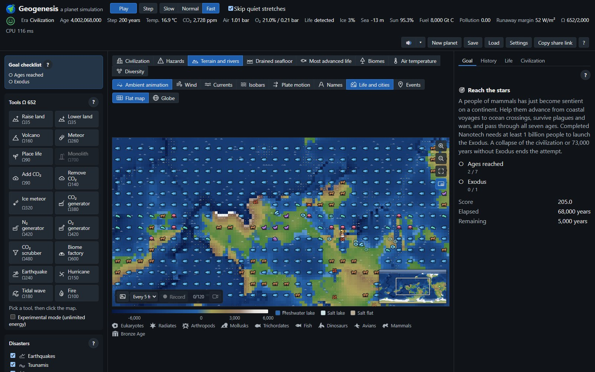

# Geogenesis: a planet simulation

**Geogenesis** is a browser-based planet simulation inspired by **SimEarth** (Maxis, 1990). Watch a planet
evolve over billions of years: plates drift and build mountains, rivers carve valleys, the climate
swings between hothouse and snowball, life evolves from microbes to sentient species, and a
civilization may rise, wreck its world or leave it for the stars. You can watch, or step in with
tools that reshape the land, the air and the living world.

> **Status: alpha 0.5.** All core models work and a young, lifeless planet evolves through
> the origin of life and microbes to civilization, with drifting plates, volcanism and an
> Earth-system climate: winds and monsoons, ocean currents, glaciers, clouds and seasons. There is not much of a game yet: a deeper physical core comes first,
> then goals, graphics and feedback. See the [milestones](#milestones).



The models are simplified but grounded in real Earth-system science: an energy-balance climate, the
silicate-weathering carbon thermostat, Whittaker biomes, Daisyworld, Landlab-style erosion. They
are coupled by Gaia-style feedbacks, so life changes the climate that shapes life.

> Geogenesis is an independent project. It is not affiliated with, endorsed by or derived from the code of Maxis or
> Electronic Arts. "SimEarth" is a trademark of its respective owner.

## Features

- **Geosphere**: tectonic plates with continental drift, collisions, subduction arcs and mid-ocean
  ridges; flow routing, fluvial erosion (stream power) and hillslope diffusion.
- **Atmosphere, ocean and climate**: a faint young Sun that brightens with age, a 2D energy-balance
  model with ice–albedo feedback (snowball Earths), a three-cell atmospheric circulation, rain
  carried by the winds (wet ITCZ, dry subtropics, rain shadows), wind-driven ocean gyres with
  warm and cold currents and upwelling, and a carbon cycle in which volcanic outgassing, rock
  weathering and organic carbon burial keep CO₂ in balance.
- **Biosphere**: biomes classified from climate, 15 life classes from prokaryotes to mammals and
  cetaceans that spread, compete and evolve, oxygen from photosynthesis (with a Great Oxidation
  Event) and methane from microbes.
- **Civilization**: sentience, seven tech ages from the Stone Age to Nanotech, cities, farming,
  industrial CO₂, plagues, nuclear wars, and Exodus.
- **Player tools** paid for with Ω energy: raise and lower land, volcanoes, meteors, placing life,
  monoliths, and adding or removing CO₂. Model controls for sun brightness, volcanism, drift,
  erosion and mutation rate.
- **Scenarios**: random planet, Daisyworld (Watson & Lovelock 1983) and Aquarium (a water world).
- **Views**: map layers (terrain and rivers, plates, temperature, precipitation, wind, ocean
  currents, biomes, life, civilization, daisies) on a flat map or an optional rotating globe,
  with animated wind and current particles over any layer; a cell inspector; history
  charts; an event log.
- **Save and load**: the whole planet in a compact binary file; the same seed always replays the
  same history.

## Play

Hosted on GitHub Pages once the repository is published (see [Deployment](#deployment)).

To run it locally you need [Node.js](https://nodejs.org/) 22 or newer:

```sh
npm install
npm run dev        # http://localhost:5173
```

### How to play

1. Press **Play**. A random planet starts 4 billion years old, with only simple microbes.
2. Switch the **map layer** to follow the climate, biomes or life, and the **view** to the globe
   if you like (drag to turn it). Hover over the map to inspect a cell.
3. Pick a **tool** and click the map to use it. Tools cost Ω energy, which builds up over time.
   Turn on experimental mode for unlimited energy.
4. Use the **model controls** to change how bright the sun is, how active the planet is, or how
   fast life mutates.
5. Watch the history charts, the life table and the event log in the tabs on the right. Complex life takes about a billion years; once a species
   becomes sentient, time slows down to centuries and then years per step.

Keyboard: **Space** play or pause, **S** one step, **1–9** map layers, **G** flat map or globe,
**Esc** put the tool down, **?** all shortcuts. Every control explains itself on hover.

## Development

```sh
npm test             # unit tests (Vitest)
npm run typecheck    # TypeScript, strict
npm run lint         # ESLint
npm run format       # Prettier
npm run build        # typecheck + production build into dist/
```

Stack: TypeScript, Vite, React for the UI, Canvas 2D for the map, uPlot for charts, Vitest.

### Architecture

```
src/sim/      pure simulation core (no DOM or React, runs in a Web Worker)
  core/       grid, fields, planet state, seeded RNG, component interface
  models/     geosphere/, atmosphere/, biosphere/, civilization/
  data/       tunable tables: biomes, life classes, tech ages
  scenarios/  world factories
  tools/      player tools
src/render/   map layers and the globe projection
src/worker/   simulation Web Worker and its message protocol
src/ui/       React UI and charts
src/i18n/     UI strings
```

- **Fields and components** (after [Landlab](https://landlab.github.io/)): per-cell data lives in
  named typed arrays, and each process is a component that declares the fields it reads and
  writes. The orchestrator checks the order and runs slow components less often (geology every
  100 kyr, evolution every 10 kyr), so a step can be 1 million years or 5 years.
- **Grid**: an equirectangular latitude–longitude grid (128×64 to 512×256) that wraps east–west.
  It uses real cell areas and distances, so the results do not depend on the resolution.
- **Determinism**: all randomness comes from a seeded generator stored in the planet state; the
  state is plain data, so it can be saved, loaded and sent to the worker.

[`CLAUDE.md`](CLAUDE.md) describes each model and the design decisions in more detail.

## Milestones

Alpha 0.1 is a working model. The aim is a game: clear to pick up, with goals, tension
and feedback that shows what your actions did. The physical core comes first — the planet's
abiotic layers (tectonics, volcanism, atmosphere), then life's great turning points — and the
game layers are built on top of it once it is tuned. Each milestone ends with a minor release.

| Milestone                         | Content                                                                                                                                                                                                                                                                                                                                                                                                                                                                                                                                                                                                                                                                                                                                                                                                                                                                                                                                                                                                                                                                       | Release |
| --------------------------------- | ----------------------------------------------------------------------------------------------------------------------------------------------------------------------------------------------------------------------------------------------------------------------------------------------------------------------------------------------------------------------------------------------------------------------------------------------------------------------------------------------------------------------------------------------------------------------------------------------------------------------------------------------------------------------------------------------------------------------------------------------------------------------------------------------------------------------------------------------------------------------------------------------------------------------------------------------------------------------------------------------------------------------------------------------------------------------------- | ------- |
| **M0** Scaffold ✅                | Vite + React + TypeScript, grid and field model, component pipeline, seeded RNG, tests                                                                                                                                                                                                                                                                                                                                                                                                                                                                                                                                                                                                                                                                                                                                                                                                                                                                                                                                                                                        | 0.1     |
| **M1** Geosphere ✅               | Plate-based terrain, continental drift, tectonic uplift, flow routing, stream-power erosion, diffusion; simulation in a Web Worker                                                                                                                                                                                                                                                                                                                                                                                                                                                                                                                                                                                                                                                                                                                                                                                                                                                                                                                                            | 0.1     |
| **M2** Climate ✅                 | Stellar evolution, energy-balance climate with ice–albedo feedback, precipitation, carbon cycle, history charts, Daisyworld                                                                                                                                                                                                                                                                                                                                                                                                                                                                                                                                                                                                                                                                                                                                                                                                                                                                                                                                                   | 0.1     |
| **M3** Biomes ✅                  | Whittaker biome classification; biomes feed back on albedo and weathering; map legends                                                                                                                                                                                                                                                                                                                                                                                                                                                                                                                                                                                                                                                                                                                                                                                                                                                                                                                                                                                        | 0.1     |
| **M4** Life ✅                    | 15 life classes, spreading and evolution, oxygen and methane, Great Oxidation Event                                                                                                                                                                                                                                                                                                                                                                                                                                                                                                                                                                                                                                                                                                                                                                                                                                                                                                                                                                                           | 0.1     |
| **M5** Civilization ✅            | Sentience, tech ages, settlements, emissions, plagues, nuclear war, Exodus; variable time step; event log                                                                                                                                                                                                                                                                                                                                                                                                                                                                                                                                                                                                                                                                                                                                                                                                                                                                                                                                                                     | 0.1     |
| **M6** Player ✅                  | Tools with the Ω energy budget, model controls, save and load, Aquarium scenario, cell inspector, speed setting                                                                                                                                                                                                                                                                                                                                                                                                                                                                                                                                                                                                                                                                                                                                                                                                                                                                                                                                                               | 0.1     |
| **M7** Presentation ✅            | Optional globe view, CI, GitHub Pages deployment, README                                                                                                                                                                                                                                                                                                                                                                                                                                                                                                                                                                                                                                                                                                                                                                                                                                                                                                                                                                                                                      | 0.1     |
| **M8** Interface ✅               | Reorganise the screen: the planet in the middle, a compact top bar with time controls and key stats, tools on the side, collapsible panels for charts, life, civilization and events. Keyboard shortcuts, tooltips on every control, a layout that works on smaller screens.                                                                                                                                                                                                                                                                                                                                                                                                                                                                                                                                                                                                                                                                                                                                                                                                  | 0.2     |
| **M9** Earth system ✅            | Eras with SimEarth-like time scales; three-cell circulation, monsoons, moisture-budget precipitation; wind-driven ocean currents and upwelling; sea level from land ice, aridity biomes, lakes; glaciers, glacial erosion, sediments, clouds; axial tilt and seasons. Wind, current, pressure, cloud and season views.                                                                                                                                                                                                                                                                                                                                                                                                                                                                                                                                                                                                                                                                                                                                                        | 0.3     |
| **M10** Plates and volcanism ✅   | Plates that stay whole: no fragments, rifting that splits continents into new plates, dying plates merged, so a supercontinent cycle can emerge. Volcanism where it belongs: arcs, ridges, rifts and mantle hotspots that build island chains; outgassing from these sources; eruptions, aerosol cooling and rare large igneous provinces.                                                                                                                                                                                                                                                                                                                                                                                                                                                                                                                                                                                                                                                                                                                                    | 0.4     |
| **M11** Young planet ✅           | Start on a young planet without life (a quick start later in history stays available): the origin of life, slower microbial evolution, a late heavy bombardment that brings water and can sterilise the surface, continents that grow over billions of years while the mantle cools and plates slow down.                                                                                                                                                                                                                                                                                                                                                                                                                                                                                                                                                                                                                                                                                                                                                                     | 0.5     |
| **M12** Atmosphere and planets ✅ | Surface pressure and nitrogen, water vapour feedback, runaway greenhouse and loss of the oceans, a variable water inventory; planet size, distance and type of star (including tidally locked worlds), rotation rate; atmospheric escape and a magnetic field that fades as the core cools; optionally a moon that steadies the tilt. Calibrated on Earth, Mars and Venus.                                                                                                                                                                                                                                                                                                                                                                                                                                                                                                                                                                                                                                                                                                    | 0.6     |
| **M13** Turning points of life    | The Cambrian explosion and mass extinctions with their causes: large igneous provinces, ocean anoxia (oxygen and phosphorus in the sea), ocean acidification, methane from clathrates and permafrost, rapid climate change. A biodiversity index with recovery and adaptive radiation afterwards. Dust in the air from eruptions, impacts and nuclear war that dims the Sun for years (impact winter); thresholds where too little or too much oxygen or CO₂ harms life; shelf seas and upwelling nutrients that feed marine life; more advanced classes displacing older ones; thermohaline overturning in the ocean. Classes with the same niche share a cell's carrying capacity instead of excluding each other.                                                                                                                                                                                                                                                                                                                                                          | 0.7     |
| **M14** Goals (M14a, M14b ✅)     | Scenarios with objectives and an end, after SimEarth. M14a: a saved, data-driven goal framework with restricted controls, a live checklist, a score and win/loss screens; playable Brightening Sun (starts at 5.6 Gyr, as CO₂ starvation thins land life ahead of the natural runaway greenhouse at ~7 Gyr, and scores how long the player keeps liquid oceans and complex life), Snowball (thaw a frozen planet) and Cradle (guide a species to sentience). M14b: a Terraform Mars goal; terraforming devices that keep working until an impact or eruption destroys them (CO₂, nitrogen and oxygen generators, CO₂ scrubbers, a biome factory) and ice meteors for water; a "life detected" readout from oxygen–methane disequilibrium. Stone age on an island (lead a people from one island to Exodus) and Earth from the Cambrian (a sandbox with the first sea animals and bare land). Terraform Venus follows as an add-on after the public beta (it needs a climate calibration for its slow rotation and dense nitrogen, and steam that rains out under a sunshade). | 0.8     |
| **M15** Challenge ✅              | Switchable earthquakes and tsunamis at plate boundaries, cyclones, droughts, dust storms, asteroid impacts and supervolcanoes; a hazard map and notable disaster markers; directed earthquake, hurricane, tidal-wave and fire tools. Civilization choices balance five age-unlocked energy sources and five investments; buried life forms finite fossil reserves, depletion constrains industry and raises war risk, and CO₂, pollution and nuclear winter feed back on the planet.                                                                                                                                                                                                                                                                                                                                                                                                                                                                                                                                                                                          | 0.9     |
| **M16** Graphics                  | A consistent visual style: icons for events, tools, layers and charts, clearer and better-looking charts, redesigned menus and dialogs. **Done:** chart axes and units, synchronized hover readouts, era bands, event marks and a per-scenario chart picker; map markers for recent located events, SimEarth-style life/city/device icon overlays on every map layer with matching event-log icons; and a Walter–Lieth climate diagram for the selected place. Still planned: a map of events, mantle-flow arrows, a view without the ocean that shows the seafloor, names of plates and landmarks.                                                                                                                                                                                                                                                                                                                                                                                                                                                                           | 0.10    |
| **M17** Feedback                  | Show what is happening and why: notifications for important events (with optional auto-pause at a new era and at key moments such as the first life, the Great Oxidation, a snowball or a mass extinction), visible effects of tools on the map, readouts that explain the climate and carbon balance (where CO₂ comes from, why it is cold), alerts when a trend turns dangerous. A Gaia face that shows how life is doing; warnings before disasters and when fuel runs low; a "current task" for each era; jump to an event on the map.                                                                                                                                                                                                                                                                                                                                                                                                                                                                                                                                    | 0.11    |
| **M18** Onboarding and balance    | A first-game guide and an in-game guide to the models; pacing so that no stretch of a game is empty (quiet billions of years pass quickly); balancing the energy budget, tool costs and civilization; performance on the finest grid. Difficulty levels (energy cap, weaker self-regulation); model changes that cost energy and take effect with a delay; context help on every control and an in-game glossary.                                                                                                                                                                                                                                                                                                                                                                                                                                                                                                                                                                                                                                                             | 0.12    |
| **M19** Sound and comfort         | Ambient music by era and sounds for key events, with volume controls; autosave, several save slots and a settings panel (grid, quality, speed); sharing a planet by seed and link; exporting a picture or a time-lapse of the planet's history; touch and tablet controls, full keyboard play, colour-blind-safe map palettes and screen-reader labels on panels; a Czech translation as the first further language.                                                                                                                                                                                                                                                                                                                                                                                                                                                                                                                                                                                                                                                          | 0.13    |
| **M20** Public beta               | Stability: long runs of every scenario without crashes or NaNs; browser compatibility; saves from the beta on stay loadable; playtests with new players and fixing what they find.                                                                                                                                                                                                                                                                                                                                                                                                                                                                                                                                                                                                                                                                                                                                                                                                                                                                                            | 0.14    |

The game is ready for a wider audience when:

- a new player can start, understand and finish a scenario without reading the source or this README;
- every scenario has a goal, and a typical game takes 20–60 minutes;
- the save format and the controls are stable;
- there are no known crashes, and a step on the default grid stays well under 100 ms.

## Known limitations

- Mean land elevation swings with tectonic history.
- Finer grids show many small islands and ragged coasts.
- The latitude–longitude grid distorts plates near the poles.

## Deployment

The `Deploy to GitHub Pages` workflow (`.github/workflows/pages.yml`) builds and publishes the game
on every push to `main`. To turn it on, go to **Settings → Pages** in the repository and set
**Source** to **GitHub Actions**. The `CI` workflow runs the type check, lint and tests on every
push and pull request.

## References

- Watson, A. J., & Lovelock, J. E. (1983). Biological homeostasis of the global environment: the
  parable of Daisyworld. _Tellus B_, 35(4), 284–289.
- North, G. R., Cahalan, R. F., & Coakley, J. A. (1981). Energy balance climate models. _Reviews of
  Geophysics_, 19(1), 91–121.
- Walker, J. C. G., Hays, P. B., & Kasting, J. F. (1981). A negative feedback mechanism for the
  long-term stabilization of Earth's surface temperature. _Journal of Geophysical Research_,
  86(C10), 9776–9782.
- Braun, J., & Willett, S. D. (2013). A very efficient O(n), implicit and parallel method to solve
  the stream power equation governing fluvial incision and landscape evolution. _Geomorphology_,
  180–181, 170–179.
- Hobley, D. E. J., et al. (2017). Creative computing with Landlab. _Earth Surface Dynamics_, 5,
  21–46.
- Whittaker, R. H. (1975). _Communities and Ecosystems_ (2nd ed.). Macmillan.

## Authors

- **Michal Břežný**: idea, direction, design decisions and testing.
- **Claude** (Anthropic), via [Claude Code](https://claude.com/claude-code): co-author of the code,
  the models and the documentation.

## License

[MIT](LICENSE) © 2026 Michal Břežný
